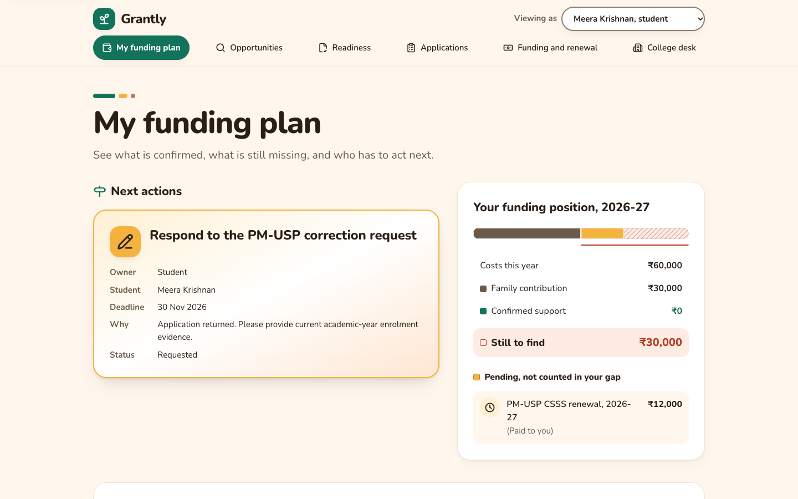
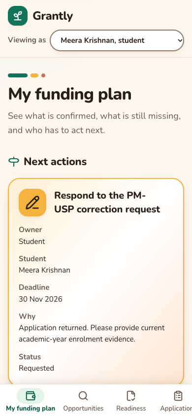
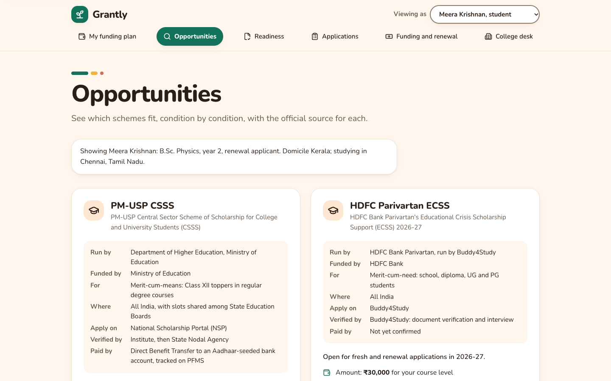
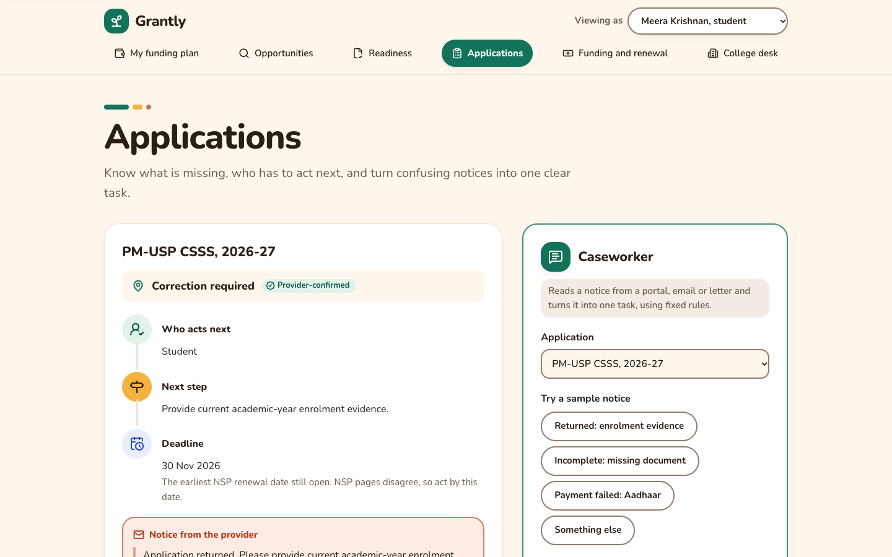
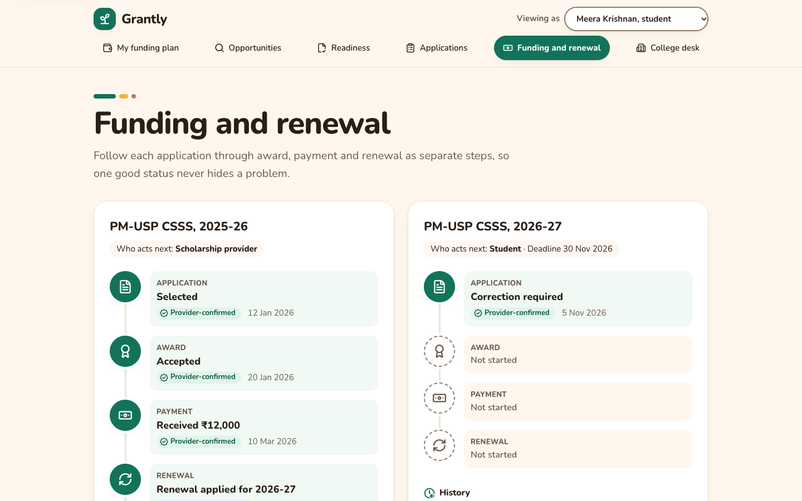

# Grantly

     

Grantly helps students in India turn scholarship opportunities into usable education funding. It answers three questions: what can I pursue, what is missing, and who has to act next. It was built for The Outpost, a 6-hour solo frontend hackathon.

**Live:** https://grantly-scholar.vercel.app

## Screenshots

| My funding plan (desktop)                                                                                         | My funding plan (mobile)                                        |
| ----------------------------------------------------------------------------------------------------------------- | --------------------------------------------------------------- |
|  |  |

| Opportunities                                                                                          | Applications                                                                        | Funding and renewal                                                        |
| ------------------------------------------------------------------------------------------------------ | ----------------------------------------------------------------------------------- | -------------------------------------------------------------------------- |
|  |  |  |

## Features

- **My funding plan:** the remaining gap counts only confirmed support. Pending applications are listed separately.
- **Application emails:** fetches emails about the student's applications, matches each to an application, and proposes status, task and funding changes that apply only after the student confirms. Emails count as evidence, a payment reported as initiated is never treated as received, and messages asking for a fee to release a scholarship are flagged as likely scams.
- **Opportunities:** each scheme is checked condition by condition (meets, does not meet, more information needed, rule needs confirmation), with the official source for every rule, amount and deadline. When official pages disagree, both dates are shown.
- **Readiness:** documents are checked against each programme's own rules, including accepted alternatives and rejected substitutes.
- **Applications:** the caseworker turns a provider notice into one task with an owner.
- **College desk:** a shared queue where a coordinator acts on requests and the student sees the result.
- **Funding and renewal:** application, award, payment and renewal stay separate tracks, each showing whether the status was provider-confirmed, supported by evidence, confirmed by college staff, or student-reported.

Use "Viewing as" to switch between Meera Krishnan (renewing PM-USP CSSS), Arjun Kumar (a fresh B.Tech applicant) and Priya Nair (a college coordinator). "Start over" in the footer restores the starting state.

## What is simulated

The Gmail connection is simulated. Grantly does not sign in to Google or read a real mailbox; "Fetch application emails" returns a fixed set of fictional emails from `example.org` addresses. Both the email reader and the caseworker use fixed, tested rules, not machine learning, and there is no backend. A real Gmail connection would need Google's restricted-scope verification for the `gmail.readonly` scope.

## Tech stack

| Tool                    | Version                                 | Why                                                                      |
| ----------------------- | --------------------------------------- | ------------------------------------------------------------------------ |
| React                   | 19.3                                    | Components and concurrent rendering                                      |
| TypeScript              | 6.0, strict, `noUncheckedIndexedAccess` | Type safety; pinned because `typescript-eslint` does not yet support 6.1 |
| Vite                    | 8                                       | Fast builds, code splitting                                              |
| React Router            | 8                                       | Lazy-loaded route per area, root error page                              |
| Zustand                 | 5                                       | Small store, persisted in `localStorage`                                 |
| Tailwind CSS            | 4                                       | Design tokens in `src/styles/tokens.css`                                 |
| Vitest, Testing Library | 5, 16                                   | Unit and component tests, 100% coverage threshold                        |
| Playwright, axe-core    | 1.65, 4                                 | End-to-end, accessibility and security-header tests                      |
| ESLint                  | 9                                       | Pinned because `eslint-plugin-jsx-a11y` does not yet support 10          |

## Project structure

```
src/
  app/          Shell, router and navigation areas
  hooks/        Shared React hooks (active person)
  routes/       One lazy-loaded page per area, plus not-found and error pages
  components/   Presentational UI (cards, badges, caseworker, email panel)
  domain/       Pure TypeScript rules: eligibility, readiness, funding, email, caseworker, dates
  data/         Scheme registry with sources, people, cases, mailbox
  store/        Zustand store and actions, persisted with a schema version
  styles/       Tokens and base styles
  test/         Setup, fixtures and render helpers
e2e/            Playwright specs
docs/           Architecture notes and screenshots
```

Data flows one way: `data` → `domain` (pure functions) → `store` → `routes` and `components`. Imports use the `@/` alias for `src/`. Saved progress is validated before it is loaded, so edited or outdated data falls back to the starting state. See [docs/ARCHITECTURE.md](docs/ARCHITECTURE.md).

## Getting started

Prerequisites: Node 22 (see `.nvmrc`).

```bash
npm install
npm run dev        # http://localhost:5173
```

No environment variables are needed; see `.env.example`.

## Available scripts

| Script               | What it does                                         |
| -------------------- | ---------------------------------------------------- |
| `npm run dev`        | Start the dev server                                 |
| `npm run build`      | Production build to `dist/`                          |
| `npm run preview`    | Serve the build with the production security headers |
| `npm run typecheck`  | `tsc --noEmit`                                       |
| `npm run lint`       | ESLint with zero warnings allowed                    |
| `npm test`           | Vitest with coverage (fails below 100%)              |
| `npm run test:watch` | Vitest in watch mode                                 |
| `npm run test:e2e`   | Playwright with axe at 360, 768 and 1440 px          |
| `npm run check`      | Type check, lint, tests and build                    |

## Testing

- **Unit and component:** Vitest, jsdom and Testing Library; 174 tests; 100% statements, branches, functions and lines, enforced by thresholds. The report is written to `coverage/index.html`.
- **End-to-end:** Playwright at phone, tablet and desktop widths: every page has zero axe violations, keyboard-only navigation works, the full journey runs, and the security headers and CSP are checked against the preview server.
- **Wording check:** a test fails if user-facing source contains placeholder wording.

## Accessibility

- Semantic landmarks, a skip link, one `h1` per page and ordered headings.
- Focus moves to the main content on navigation; every page sets its own document title.
- Labelled form controls, `aria-live` status messages, visible focus rings.
- Status is never shown by colour alone; icons and text accompany every badge.
- Respects `prefers-reduced-motion`.
- Checked by `eslint-plugin-jsx-a11y`, axe in unit and end-to-end tests, and Lighthouse (100).

## Performance

- Each area is a lazy-loaded chunk; third-party code is a separate long-cached vendor chunk.
- One variable font (Nunito), self-hosted; no animation library.
- Hashed assets use Vercel's default CDN caching, so a request made during a deploy is never cached as a long-lived 404.
- Live Lighthouse: performance 97–100 on mobile and 100 on desktop, layout shift 0.

## Security

- Content Security Policy `default-src 'self'` with no inline scripts or styles, plus HSTS, `nosniff`, `X-Frame-Options: DENY`, Referrer-Policy, Permissions-Policy, COOP and CORP (`vercel.json`).
- User text is length-capped, normalised and rendered as plain text; no `innerHTML` or `eval`.
- External links use `rel="noopener noreferrer"`.
- No secrets, API keys or network calls; `npm audit` reports 0 vulnerabilities.

## Deployment

Vercel builds every push to `main` with `npm run build` and serves `dist/`. `vercel.json` rewrites app routes to `index.html` and sets the security and cache headers.

## Data sources

Scheme facts come from official sources checked on 7 Nov 2026, listed in `src/data/sources.ts` and linked in the app:

- PM-USP Central Sector Scheme of Scholarships (National Scholarship Portal)
- HDFC Bank Parivartan's ECSS Programme
- Foundation For Excellence
- National Means-cum-Merit Scholarship (NMMSS)

Where a provider does not publish a value, Grantly says so instead of guessing.

## Contributing

See [CONTRIBUTING.md](CONTRIBUTING.md) and the [changelog](CHANGELOG.md).

## License

[MIT](LICENSE)
